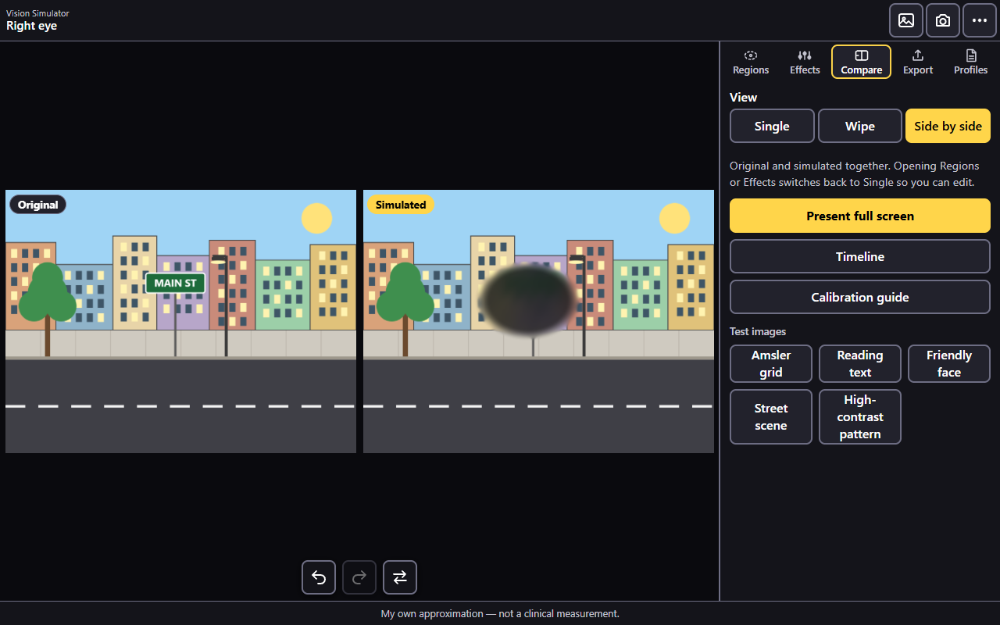
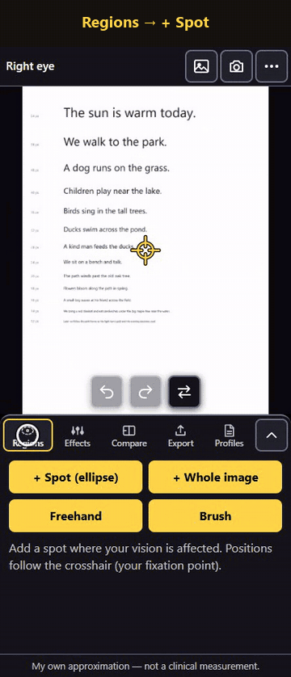
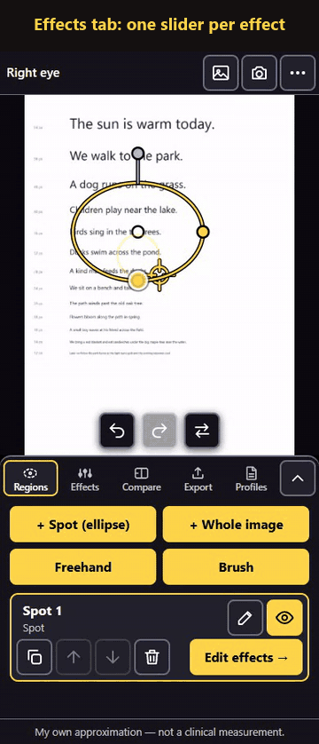
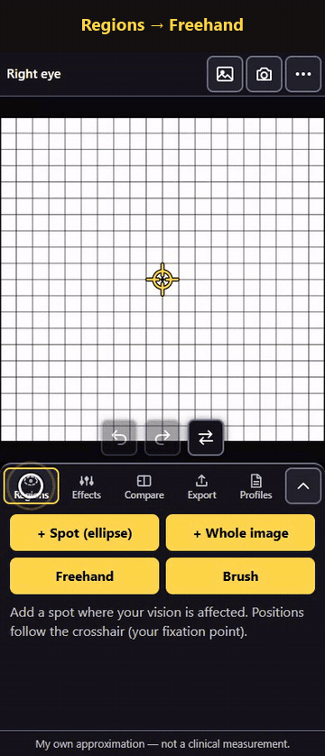
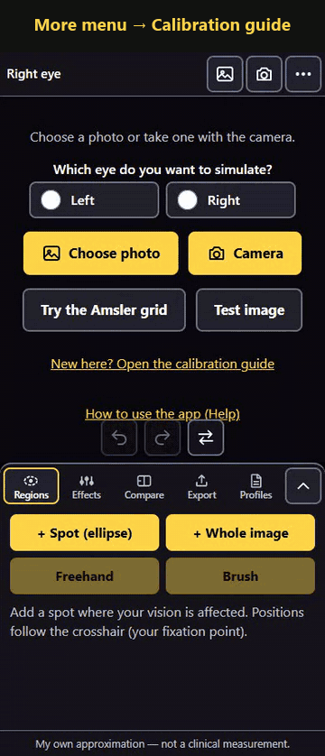
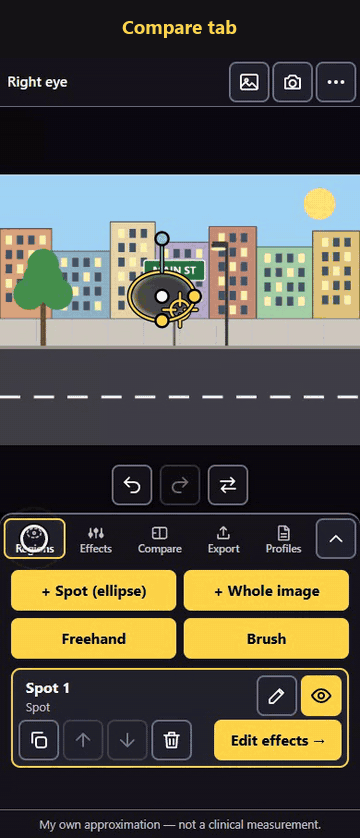
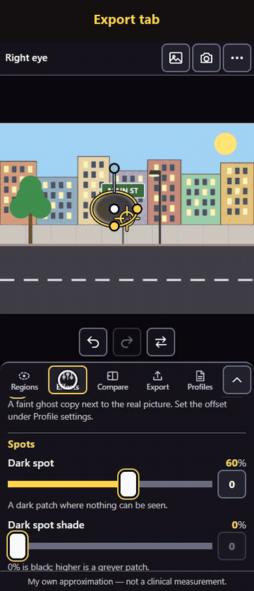
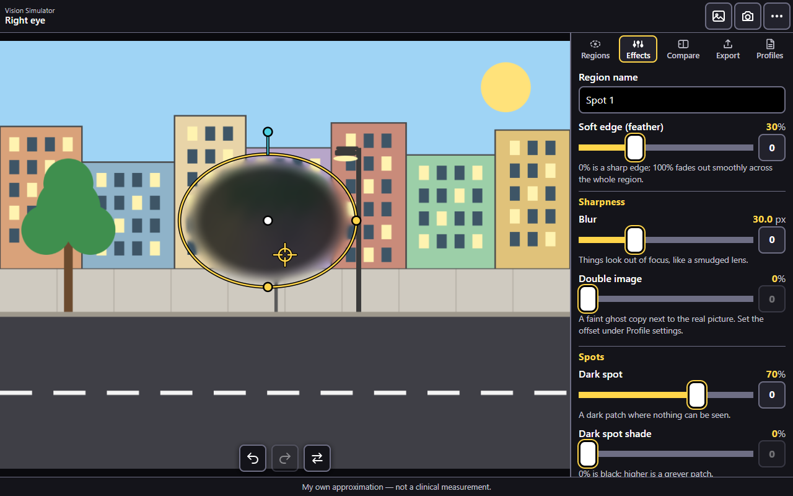

# Vision Simulator

**Show your doctor what one eye sees — on any photo, privately, on your own phone.**

Vision Simulator recreates what an affected eye sees: blur, dark or missing patches, wavy lines, things that look smaller or bigger, faded colours and more. You build the picture yourself, check it against your own eye, and show or send it to your doctor instead of trying to describe it in words.

- **Free and private.** Everything runs on your device. No account, no upload, no tracking.
- **Works on a phone.** Built for Android Chrome first; also works on a computer. Installs like an app and works offline.
- **A communication aid, not a diagnostic tool.** Every image carries the note *"My own approximation — not a clinical measurement."*

**[Open the app](https://saravanatelapolu.github.io/VisionImageSimulationTool/)** · **[Step-by-step Help](https://saravanatelapolu.github.io/VisionImageSimulationTool/help.html)**



## See it in action

| Mark the affected area | Choose the effects | Draw any shape |
| :---: | :---: | :---: |
| [](https://saravanatelapolu.github.io/VisionImageSimulationTool/help.html#spot) | [](https://saravanatelapolu.github.io/VisionImageSimulationTool/help.html#effects) | [](https://saravanatelapolu.github.io/VisionImageSimulationTool/help.html#freehand) |
| **Tap + Spot**, tap the picture, drag the dots. | One slider per effect; the picture changes live. **Flip** shows the original. | **Freehand** traces an outline; **Brush** paints patches. |
| **Calibrate with your eye** | **Compare and present** | **Save and share** |
| [](https://saravanatelapolu.github.io/VisionImageSimulationTool/help.html#calibrate) | [](https://saravanatelapolu.github.io/VisionImageSimulationTool/help.html#compare) | [](https://saravanatelapolu.github.io/VisionImageSimulationTool/help.html#export) |
| A guided check: cover one eye, notice, match, flip. | Wipe, side by side, and full-screen **Present** for the appointment. | PNG or JPEG, side-by-side, with a dated caption. Share to WhatsApp or email. |

More clips — opening a photo, the brush, profiles and check-ups — are in the **[Help page](https://saravanatelapolu.github.io/VisionImageSimulationTool/help.html)**.

## Use it in five steps

1. **Open a photo.** Choose one, take one with the camera, or try a built-in test image such as the **Amsler grid**. Pick the eye to simulate: **Left** or **Right**.
2. **Mark the area.** **Regions** tab → **+ Spot**, then tap where your vision is affected. Drag the dots to move, resize and rotate it. Use **Freehand** or **Brush** for other shapes, **+ Whole image** for problems everywhere.
3. **Pick the effects.** **Effects** tab: move the sliders until it looks like what you see. Tap **Flip** (under the picture) to compare with the original.
4. **Check it with your eye.** The **Calibration guide** (⋯ menu) walks you through it: cover your good eye, notice what looks wrong, then match the simulation.
5. **Show or share it.** **Compare** tab → **Present full screen** during the appointment, or **Export** tab → **Prepare images** → **Share** / **Download**.

Save the result in the **Profiles** tab, and make a **New check-up** each time things change; **Compare over time** shows them by date.

## What it can simulate

| Effect | What you see |
| --- | --- |
| Blur | Things look out of focus (0–100). |
| Double image | A faint ghost copy beside the real picture. |
| Dark spot | A black or grey patch where nothing can be seen; shade set per region. |
| Missing area | A gap the brain fills in with the surroundings, so no dark patch shows. |
| Distortion | Straight lines look wavy or bent. |
| Size change | Objects look smaller or bigger inside a spot. |
| Contrast loss | A washed-out, foggy look. |
| Dimming | Everything looks darker. |
| Colour fade | Colours look weaker and greyer. |



Every region has a **soft edge** setting, and effects can be combined. Each region can be renamed, hidden, duplicated, reordered or deleted, and everything can be undone.

## Privacy

There is no server: photos, eye maps and settings stay in your browser on your device. Images leave the device only when you share or download them. Profiles can be exported as a small JSON file to move them between phone and computer.

## Develop

Requires Node 18+ (Node 20 recommended).

```bash
npm ci
npm run dev           # http://localhost:5173
npm test              # unit tests (Vitest)
npm run typecheck
npm run build         # production build in dist/
npm run e2e           # Playwright smoke tests (uses installed Microsoft Edge locally)
npm run help:capture  # re-record the Help/README clips (needs ffmpeg on the PATH)
```

The Help page is a static file, [public/help.html](public/help.html); its screenshots and GIFs live in [public/help/media](public/help/media) and are made by [scripts/help-capture](scripts/help-capture) from the built app, so they can be refreshed whenever the UI changes.

Project guide for Claude Code sessions: [CLAUDE.md](CLAUDE.md). Requirements and design: [docs/Vision-Simulator-Plan.md](docs/Vision-Simulator-Plan.md). Build history: [docs/development-coding-progress.md](docs/development-coding-progress.md). Roadmap: [docs/roadmap.md](docs/roadmap.md).

## Deploy (GitHub Pages)

1. Merge into `main` and push.
2. On GitHub: **Settings → Pages → Source: GitHub Actions** (once).
3. The `deploy.yml` workflow builds and publishes on every push to `main`, at `https://<user>.github.io/VisionImageSimulationTool/`.

## Deploy on IIS (Windows Server)

```bash
npm run package:iis
```

This builds the app and creates `release/VisionSimulator-iis-<version>.zip` (add `-CleanInstall` to the script to run `npm ci` first). The zip holds:

- `site/` — the app plus the IIS [web.config](deploy/iis/web.config) (MIME type for `.webmanifest`, cache rules so updates arrive quickly);
- `install-iis.ps1` — creates the application pool ("No Managed Code") and a website or an application under an existing site, or updates the files of an existing install;
- `README.txt` — step-by-step instructions, by script or by hand in IIS Manager.

On the server, extract the zip and run from an elevated Windows PowerShell, for example `.\install-iis.ps1 -WhatIf` then `.\install-iis.ps1 -ParentSite "Default Web Site" -AppPath /VisionSim`. Use HTTPS: installing the app and offline use need it. The source files live in [deploy/iis](deploy/iis); the packaging script is [scripts/package-iis.ps1](scripts/package-iis.ps1).

No photos are ever stored in the repository or sent anywhere.
