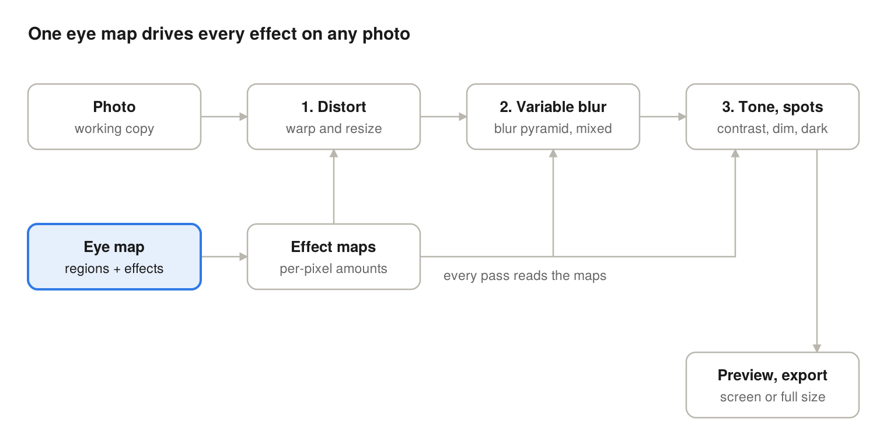

# Vision Simulator — Requirements, Design & Build Plan

Oct 16, 2026 · Saravana

## Purpose and context

Vision Simulator is a free, private web app. It lets me recreate what my right eye sees on any photo, so my doctor can see the damage instead of hearing it described. The scarring is decades old and treatment is now underway. The app should also let me record the same view again later, so we can see whether treatment is changing anything.

**Users**

- Me: I build and adjust the simulation, mostly on my phone, judging it with my good left eye.
- My doctor: views exported images or a live comparison during an appointment. Needs no install and no account.

**Success criteria**

1. The doctor says the image helps them understand my vision better than a verbal description.
2. I can build a first simulation in under 15 minutes without reading instructions.
3. The same eye map can be applied to a new photo, or to an Amsler grid, in one step.
4. Snapshots taken months apart can be compared side by side.
5. No photo ever leaves my device unless I share an export myself.

**Out of scope**

The app is a communication aid, not a diagnostic tool. It does not measure acuity or visual field, and it makes no medical claims.

## Functional requirements

The core idea is an **eye map**: a set of affected regions defined relative to where I am looking (the fixation point), not to a particular photo. Retinal damage moves with my gaze, so one map should apply to any image.

**F1. Image input**

- Load a photo from the camera, gallery or file picker (JPEG, PNG, HEIC where the browser supports it).
- Built-in test images: Amsler grid, reading text at several sizes, a face, a street scene, a high-contrast pattern.
- Downscale large images to a working size (for example 2048 px on the long side) and keep the original for export.

**F2. Fixation point**

- A crosshair marks the fixation point, placed in the centre by default and draggable.
- All regions are stored relative to it, scaled by the image's shorter side.

**F3. Regions**

| Shape | How it is drawn | Use |
| --- | --- | --- |
| Ellipse | Tap to place, drag handles to resize and rotate | Most scars and blind spots |
| Freehand area | Draw a closed outline with a finger | Irregular scars |
| Brush mask | Paint and erase with an adjustable brush | Fine edges, patchy areas |
| Whole image | One toggle | Overall haze or dimness |

- Each region has a feather (soft edge) slider from 0 to 100% of its size.
- Regions can be selected, duplicated, hidden, reordered and deleted.
- Overlapping regions combine; the stronger effect wins per effect type.

**F4. Effects per region**

| Effect | Control | What it shows |
| --- | --- | --- |
| Blur | Strength 0 to 40 px | Loss of sharpness |
| Dark spot | Opacity 0 to 100%, colour grey to black | Scotoma seen as a dark patch |
| Missing area | Strength 0 to 100% | Scotoma the brain "fills in": surrounding texture smeared across it, no dark patch |
| Distortion | Amplitude, wave size, direction | Wavy or bent lines (metamorphopsia) |
| Size change | Shrink or enlarge 0 to 30% | Objects looking smaller or larger |
| Contrast loss | 0 to 100% | Washed-out, foggy look |
| Dimming | 0 to 100% | Darker vision in that area |
| Colour fade | Desaturation 0 to 100% | Weaker colour perception |
| Double image | Offset and opacity | Ghosting |

- Every slider updates the preview live.
- A region shows only the effects I switch on; all start at zero.

**F5. Calibration helper**

- Guided mode: hold the phone at a set distance, cover the left eye, stare at the fixation mark, and note what looks wrong.
- Then uncover the left eye, cover the right eye, and adjust the simulation until it matches.
- A "flip" button switches between the original and simulated views quickly, to help this comparison.
- A distance reminder (for example 40 cm) is saved with the profile, since region size depends on it.

**F6. Compare and present**

- Before/after slider that wipes across the image.
- Side-by-side view, stacked vertically on a phone.
- Full-screen presentation mode for showing the doctor.

**F7. Export**

- Save the simulated image as PNG or JPEG.
- Optional caption burned into the image: date, eye, viewing distance, short note.
- Optional side-by-side export with the original.
- Share through the phone's share sheet (WhatsApp, email).

**F8. Profiles and history**

- Save an eye map as a named, dated profile.
- Duplicate a profile to record a new check-up without losing the old one.
- Timeline view: the same test image rendered with each dated profile, side by side.
- Export and import profiles as a small JSON file, for backup or to move between phone and laptop.

**F9. Undo**

- Undo and redo for every edit, at least 50 steps.

## Non-functional requirements

| Area | Requirement |
| --- | --- |
| Privacy | All processing happens in the browser. No server, analytics, accounts or third-party calls at runtime. |
| Cost | Free to build, host and use. Static hosting only (GitHub Pages). |
| Offline | Installable as a PWA; works with no network after the first visit. |
| Platforms | Latest Chrome on Android, Safari on iOS, Chrome and Edge on desktop. Phone first, at 360 px width and up. |
| Performance | Slider changes redraw in under 50 ms on a mid-range phone at 1024 px preview size. Export at full size may take a few seconds. |
| Storage | Profiles in IndexedDB on the device; photos stored only if I choose to save them with a profile. |
| Accessibility | Large touch targets (at least 44 px), high-contrast UI, adjustable UI text size, every control usable one-handed. |
| Honesty | A visible note that the image is my own approximation, not a clinical measurement. |
| Maintainability | TypeScript, small modules, unit tests for the maths, a CLAUDE.md that explains the project to future sessions. |

## Design

The app is a single-page static site. The eye map is turned into per-pixel effect maps, then three GPU passes apply them to the photo.



The photo flows left to right through three passes; the eye map is rasterised once into effect maps that every pass reads.

### Tech stack

| Layer | Choice | Why |
| --- | --- | --- |
| Language | TypeScript | Catches mistakes in the geometry and data model |
| Build | Vite | Fast, simple static output |
| UI | Preact with signals | Small (about 4 kB), familiar component model |
| Rendering | WebGL2 fragment shaders | Live blur and warp on a phone; Canvas 2D filters are too slow and inconsistent on Safari |
| Storage | IndexedDB via the idb library | Profiles and optional photos stay on the device |
| Offline | vite-plugin-pwa | Installable, works without network |
| Tests | Vitest, plus Playwright for a smoke test | Maths unit tests; one end-to-end check |
| Hosting | GitHub Pages | Free, deploys from the repo |

### Rendering pipeline

1. **Effect maps (CPU, Canvas 2D).** Each region is drawn as a feathered shape into two RGBA textures. Each channel holds one effect's strength from 0 to 1. Map A: blur, distortion, contrast loss, dimming. Map B: dark spot, missing area, colour fade, double image. Overlaps use the maximum value. Maps are rebuilt only when a region changes.
2. **Distortion pass.** Texture coordinates are displaced by a smooth sine-and-noise field, scaled by the distortion channel. Size change is computed from each ellipse's centre, for up to 8 ellipses passed as uniforms.
3. **Variable blur pass.** A blur pyramid is built once per image at radii of 2, 4, 8, 16 and 32 px, using separable Gaussian passes. Each pixel blends the two levels nearest its blur value. The largest level also supplies the smeared texture for "missing area".
4. **Tone and spots pass.** Applies contrast loss, dimming, colour fade, the offset ghost for double image, and finally the dark spot.
5. **Output.** The preview renders at up to 1024 px. Export re-runs the same passes at full size, with all pixel radii scaled to match.

To keep the shaders simple, distortion wave size and direction, and the double-image offset, are set once per profile. Regions control only how strongly they apply.

### Data model

Coordinates are relative to the fixation point and measured in units of the image's shorter side. The same profile therefore lands in the same place on any photo.

```json
{
  "version": 1,
  "id": "p-2026-10-16",
  "name": "Right eye, October 2026",
  "eye": "right",
  "createdAt": "2026-10-16T18:00:00Z",
  "viewingDistanceCm": 40,
  "note": "Before second treatment session",
  "globals": { "distortWaveSize": 0.05, "distortAngle": 30, "ghostOffset": [0.01, 0] },
  "regions": [
    {
      "id": "r1",
      "name": "Central scar",
      "visible": true,
      "shape": { "type": "ellipse", "cx": 0.05, "cy": -0.02, "rx": 0.12, "ry": 0.09, "rotation": 15 },
      "feather": 0.4,
      "effects": { "blur": 18, "darkSpot": 0.6, "fillIn": 0, "distortion": 0.3, "sizeChange": 0, "contrastLoss": 0.4, "dimming": 0.2, "colourFade": 0, "doubleImage": 0 }
    }
  ]
}
```

Other shape types: `path` holds a list of points; `mask` holds a PNG data URL of a painted mask; `full` covers the whole image.

### Code layout

- `src/model/` profile types, validation, undo history
- `src/render/` effect-map builder, WebGL passes, shaders, export
- `src/ui/` canvas view, region handles, bottom-sheet panels
- `src/storage/` IndexedDB access, JSON import and export
- `src/assets/` Amsler grid and other test images

### Screen layout (phone)

- **Top bar:** profile name, undo, redo, flip (original vs simulated).
- **Canvas:** the image, fixation crosshair, region outlines and handles. Pinch to zoom, two-finger pan.
- **Bottom sheet with four tabs:** Regions (list and add buttons), Effects (sliders for the selected region), Compare (slider, side by side, timeline), Export.
- On desktop the sheet becomes a right-hand sidebar.

## Incremental build plan

Eight phases, each a working, deployed app. After phase 2 there is already something useful to show the doctor.

1. **Phase 0: Scaffold and deploy**
   - Vite, TypeScript, Preact, Vitest, CLAUDE.md, GitHub Actions deploy to GitHub Pages.
   - Load a photo from the phone and show it fitted to the screen.
   - Done when: the live URL opens on my phone and displays a chosen photo.
2. **Phase 1: Rendering core**
   - WebGL2 setup, blur pyramid, one whole-image blur slider, PNG export.
   - Done when: the slider redraws smoothly on my phone and the export matches the preview.
3. **Phase 2: Ellipse regions (first useful version)**
   - Fixation crosshair, ellipse regions with move, resize, rotate and feather.
   - Effect maps; blur and dark spot per region; region list with hide and delete.
   - Done when: I can make a rough simulation of my right eye and export it to show the doctor.
4. **Phase 3: All effects and undo**
   - Distortion, size change, contrast loss, dimming, colour fade, missing area, double image.
   - Profile-level wave and ghost settings; undo and redo.
   - Done when: every effect in F4 works on a region, and an Amsler grid shows visible waviness.
5. **Phase 4: Calibrate, compare, present**
   - Built-in test images, calibration guide, flip button.
   - Before/after slider, side-by-side view, full-screen presentation mode.
   - Done when: I can complete the calibration steps and present a before/after to the doctor.
6. **Phase 5: Profiles and history**
   - Save, duplicate and rename dated profiles in IndexedDB; JSON import and export.
   - Timeline view; captioned and side-by-side exports; share sheet.
   - Done when: a profile saved on the phone opens on the laptop, and two dated profiles show side by side.
7. **Phase 6: Freehand and brush regions**
   - Freehand outline and brush mask shapes, with erase.
   - Done when: an irregular scar shape can be traced and edited.
8. **Phase 7: Offline and polish**
   - PWA install and offline use, accessibility pass, Safari on iOS testing, performance check against the 50 ms target.
   - Done when: the app works in airplane mode and passes the non-functional table.

Each phase should be one or two Claude Code sessions and one pull request.

## Building it with Claude Code on the web

The repo is the shared memory: this plan lives in it, and each session builds one phase and opens a pull request.

### One-time setup

1. Create an empty GitHub repository, for example `vision-simulator`. Keep it public so GitHub Pages hosting is free. No photos ever go in the repo.
2. Export this doc as Markdown and commit it as `docs/PLAN.md`.
3. Open Claude Code on the web, connect GitHub, and select the repository.
4. In the first session, ask Claude to write `CLAUDE.md`: project purpose, stack, folder layout, coding rules, how to run tests, and "read docs/PLAN.md before each phase".

### Prompt for each phase

```markdown
Read CLAUDE.md and docs/PLAN.md. Implement Phase <N> only.

1. First, reply with a short plan: files to add or change, and any open questions.
2. Then implement it, with unit tests for any maths or data-model code.
3. Run the build and tests, and fix failures.
4. Update CLAUDE.md if conventions changed, and tick off Phase <N> in docs/PLAN.md.
5. Open a pull request titled "Phase <N>: <name>" listing what to check on a phone.
```

### Review loop

1. Read the pull request summary and the checklist.
2. Open the deployed preview on the phone and test the "Done when" line for that phase.
3. Ask for fixes in the same session, or merge and start the next phase in a new session.

### Keeping it efficient

- One phase per session keeps context small and costs predictable.
- Ask for the plan before code; correcting a plan is cheaper than correcting code.
- Keep CLAUDE.md short and current, so each new session starts informed without re-reading everything.
- For shader bugs, describe what you see and attach a screenshot rather than asking for a rewrite.

## Open questions and risks

**Open questions**

- [ ] Which effects match what my right eye sees? This decides which phase 3 effects matter most.
- [ ] Does the doctor have visual field or Amsler results I could use to place regions more accurately?
- [ ] How does the doctor prefer to receive images: printed, on my phone at the visit, or by WhatsApp or email?
- [ ] Is a left-eye profile useful as a baseline, or only the right eye?
- [ ] What viewing distance should be standard, so later snapshots are comparable?

**Risks**

| Risk | Effect | Mitigation |
| --- | --- | --- |
| Brain "fills in" blind spots, so I may not notice them | The simulation misses areas | Calibrate on the Amsler grid; use the "missing area" effect, not only dark spots |
| Judging with one eye while the other is covered is tiring | Inconsistent profiles over time | Fixed distance, fixed test image, short sessions |
| Shader quirks on iOS Safari | Effects look wrong or slow on iPhone | Test on Safari from phase 1; keep a lower preview size option |
| Large phone photos exceed GPU texture limits | Blank output on export | Check the device's maximum texture size and tile the export if needed |
| Images read as clinical evidence | Misplaced confidence | Visible approximation note on screen and in captions |
